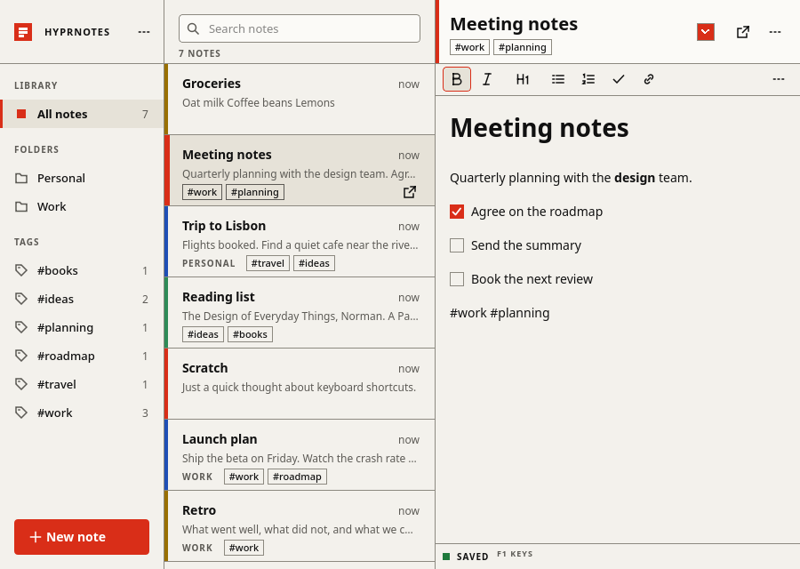

# Hyprnotes

Hyprnotes keeps Markdown notes in a folder you choose. The organizer handles your notes, and each one can open in its own floating window.



## What it does

- Edit Markdown with the formatting toolbar or in source mode. Opening a note does not rewrite it.
- Search notes, organize them with tags and folders, or open one in a separate sticky window.
- Autosave, crash recovery, and a clear conflict prompt if another program changes a note you have open.
- A flat Modernist theme in light and dark, plus imports from Hyprnotes JSON, base16 and VS Code themes.
- Lua plugins can add commands, typing triggers, side panels and `[[link]]` completion. A built-in browser lists plugins, and Ctrl+Shift+P opens the command palette.
- Runs as a single instance and can stay in the tray.

Hyprnotes is written in C++20 with Qt 6 for Arch Linux and Hyprland on Wayland.

## Install

You need Arch Linux (or another pacman-based distro) on x86_64 and a Wayland session. Build the package from a clone with these steps; you do not need a published release.

1. Install the build tools. The runtime libraries come in automatically when you install the package.

   ```sh
   sudo pacman -S --needed git base-devel cmake ninja
   ```

2. Clone the repository and build the package. This runs as your normal user and installs nothing; the package lands in `packaging/out/pkg/`.

   ```sh
   git clone https://github.com/RolittapesReal/hyprnotes.git
   cd hyprnotes
   packaging/build-package.sh
   ```

3. Install it. pacman lists what it will do and asks before it continues.

   ```sh
   sudo pacman -U packaging/out/pkg/hyprnotes-*.pkg.tar.zst
   ```

4. Start it. On first launch it asks where to keep your notes (default `~/Notes/Hyprnotes`) and then opens the organizer.

   ```sh
   hyprnotes
   ```

To update, pull the latest changes, rebuild, then repeat step 3. Close Hyprnotes before installing so the next launch uses the new version. `sudo pacman -R hyprnotes` removes it and leaves your notes and settings alone.

If you'd rather not build, download the signed package from the [releases page](https://github.com/RolittapesReal/hyprnotes/releases). [docs/install.md](docs/install.md) covers verifying it, the bootstrap script, the tray and Hyprland setup, and what to do when something goes wrong.

## Use

```
hyprnotes [--show-organizer | --new-note | --background]
```

Running it again talks to the instance that is already open. The tray icon appears when a StatusNotifier host is available, such as Waybar with its `tray` module enabled. Optional Hyprland window rules and key binds are in `/usr/share/hyprnotes/hyprland/`; add them to your config if you want them.

Settings live in `~/.config/hyprnotes/`, see [docs/theme-reference.md](docs/theme-reference.md).

## Plugins

Plugins can change how Hyprnotes behaves, but this project does not review them. Depending on its permissions, a plugin can read or change notes or send data over the network. Install plugins only from sources you trust; a plugin remains disabled until you approve its permissions.

Open Settings > Plugins > Browse to see entries from the [hyprnotes-plugins](https://github.com/RolittapesReal/hyprnotes-plugins) registry. Hyprnotes contacts GitHub only after you open the tab and accept its notice. It checks each download against the registry hash before showing the permission dialog. This detects a damaged download; it does not establish that a plugin is safe. Native plugins appear in the list but cannot yet be installed there.

Start with [docs/plugins.md](docs/plugins.md). `hyprnotes --new-plugin NAME` creates a working template, and there are examples in `examples/plugins/`.

## Build from source

You need cmake, ninja, qt6-base, qt6-svg, md4c, sqlite (3.35 or newer), lua and libarchive.

```sh
cmake -S . -B build -G Ninja
cmake --build build
ctest --test-dir build
```

## Status

Version 0.2.1, release in preparation. See the [release notes](CHANGELOG.md). The 0.2.1 work includes fixes for Markdown list save/reopen behavior and Organizer pagination during sync. Broader hardening qualification is deferred.

Before the 0.2.1 version update, the full Release suite passed 88/88 and the matching ASan/LSan/UBSan run passed 87/88, with one unchanged load-time assertion failing and no sanitizer diagnostics. The final focused regression run passed all three targets. Numeric performance and memory failures remain recorded; reducing scope did not turn them into passes. Compositor checks come from one Arch/Hyprland setup and do not establish compatibility across machines. See the [testing notes](docs/testing.md) for evidence and limits, and the [live-test recipe](tests/live/README.md) for isolated compositor checks.

## License

MIT, see [LICENSE](LICENSE).
